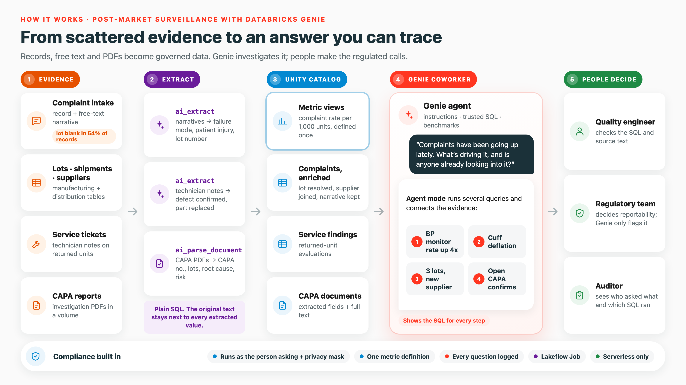
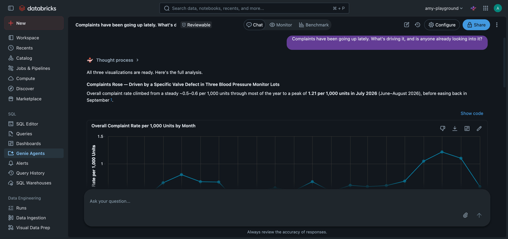
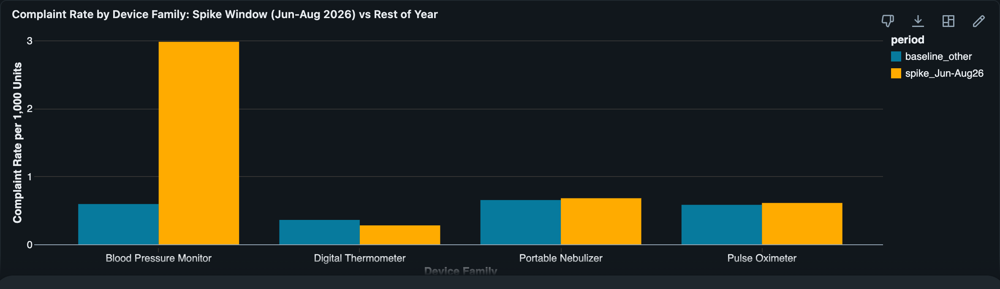
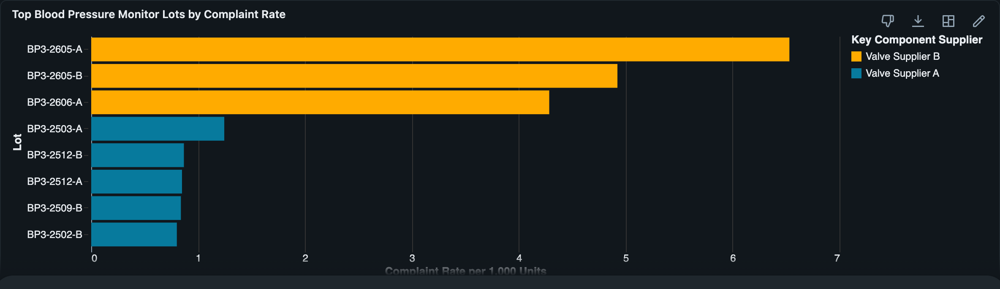
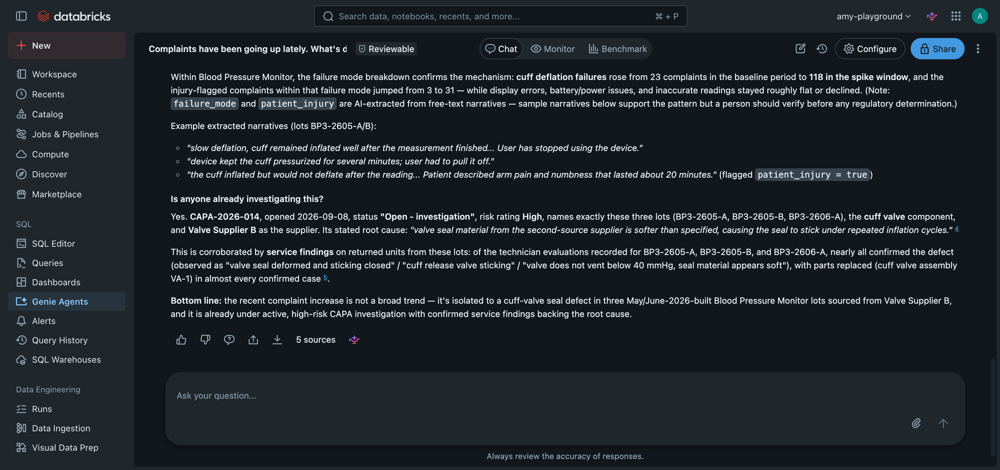

# Post-market surveillance with Databricks Genie

A small, runnable example of an AI coworker for a medical device quality team. It shows how
[Databricks Genie](https://docs.databricks.com/aws/en/genie/) answers a question like

> *"Complaints have been going up lately. What's driving it, and is anyone already looking into it?"*

by working across structured records **and** unstructured text and documents, inside the controls a regulated
quality system needs: governed data access, one certified metric definition, and an audit trail of every answer.

All data is synthetic. No real company, product, patient, or complaint is represented.



## What it demonstrates

| Step | Notebook | Databricks capability |
|---|---|---|
| 1 | `01_generate_structured_data` | Delta tables in Unity Catalog: device families, suppliers, lots, shipments, complaints, service tickets |
| 2 | `02_generate_capa_documents` | CAPA investigation reports as PDFs in a Unity Catalog volume |
| 3 | `03_extract_structure_from_text` | `ai_extract` on complaint narratives and technician notes; `ai_parse_document` + `ai_extract` on PDFs |
| 4 | `04_gold_metrics_and_governance` | Gold tables, **metric views** for a certified complaint rate, column comments, tags, a **column mask** |
| 5 | `05_build_genie_agent` | A Genie agent defined as code: data sources, instructions, trusted SQL, sample questions, benchmarks |
| 6 | `06_audit_trail` | `system.access.audit` and `system.query.history`: who asked what, and the SQL that answered it |

## The planted signal

The dataset covers four device families from January 2025 to September 2026. Three lots of the blood pressure monitor, built in May and June 2026, use cuff valves from a newly qualified second-source supplier. Those lots produce
a rise in complaints describing a cuff that will not deflate, some with patient injury.

The details a person needs to find this are spread across sources:

* The **lot number is blank in about half of the complaint records**. It appears only in the free-text narrative.
* The **failure mode and injury** exist only in the narrative.
* **Service technicians** confirm the valve defect in free-text notes.
* The **open CAPA** that names the supplier and lots is a PDF.

Notebook 03 extracts these facts into columns. Genie can then connect them in one conversation.

## Run it

### Option A: Databricks Free Edition (recommended for readers)

1. Sign up for [Databricks Free Edition](https://www.databricks.com/learn/free-edition).
2. In the workspace, select **Workspace → Create → Git folder** and paste this repository URL.
3. Open the notebooks in order and run each one on **Serverless** compute. Keep the widget defaults
   (`catalog = workspace`, `schema = pms_genie_cowork`). Notebook 05 prints a link to the Genie agent.

### Option B: Databricks CLI and Asset Bundles

```bash
databricks bundle deploy -t free --profile <your-profile>
databricks bundle run pms_genie_setup -t free --profile <your-profile>
```

Override `catalog`, `schema` or `warehouse_id` with `--var`, for example `--var catalog=main`.

The full run takes about 10 minutes, most of it in the AI Functions step.

## Questions to ask the agent

* Complaints have been going up lately. What's driving it, and is anyone already looking into it?
* Why did blood pressure monitor complaints rise in Q3 2026?
* Which lots have the highest complaint rate?
* Compare complaint rate by supplier for the blood pressure monitor.
* Is there an open CAPA for the blood pressure monitor cuff deflation issue?
* What did service find on returned units from lot BP3-2605-B?
* How many complaints only had the lot number in the narrative?

In Agent mode, the first question produces a multi-step investigation. Genie works out which product is driving the
increase, then the failure mode behind it, the lots and supplier behind it, and the open CAPA and service findings that confirm it.









Each answer shows the SQL Genie ran. Open notebook 06 with the agent's space ID to see the same activity in the
system tables.

## Design notes

* **Extract, then query.** Genie answers with SQL, so facts in text and PDFs are extracted into columns first.
  The original narrative and document text stay next to the extracted values so every number can be traced back.
* **One definition of complaint rate.** The metric views define complaint rate once. The agent instructions tell
  Genie to use that measure instead of computing its own.
* **Genie runs as the person asking.** Unity Catalog grants and the column mask on reporter contact details apply
  to every answer.
* **People keep the regulated decisions.** The instructions tell Genie to flag injury complaints for reportability
  assessment and never decide reportability itself.

## Clean up

```sql
DROP SCHEMA workspace.pms_genie_cowork CASCADE;
```

Then delete the *Post-Market Surveillance Coworker* agent from the Genie page.

## Disclaimer

This is an educational example, not a validated system. All data is synthetic, and the company, products, suppliers,
lots, and CAPA reports are fictional. The metric definitions and workflow are illustrative; a production quality
system must follow your organization's procedures and applicable regulations.

These resources are provided as-is for guidance and educational purposes. They are not official Databricks tools or
supported products, and Databricks support does not cover this content. Test and validate all code in your own
environment before use.
